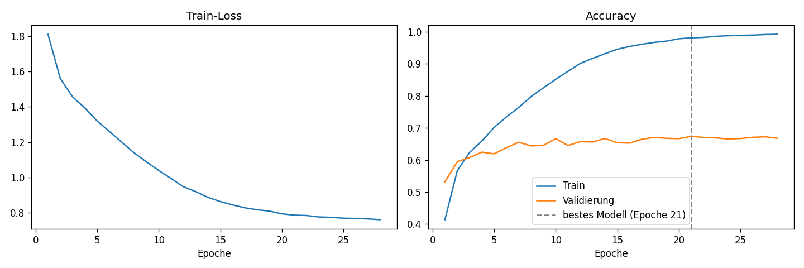

# Emotion Recognition

Projekt aus dem Modul *Grundlagen der Computer Vision* (SoSe 2025, OVGU Magdeburg), zusammen mit Miká und Konstantin.

Mein Teil im Team waren die Deep-Learning-Modelle (eigenes CNN und ResNet34), dazu habe ich am FACS-Ansatz und an der Präsentation mitgearbeitet.

Die Frage war ziemlich einfach: Wie gut kann man Emotionen auf kleinen Gesichtsbildern erkennen, und wie viel bringt Deep Learning gegenüber klassischen Verfahren wirklich? Wir haben dafür zuerst mit Kantenfiltern und HOG-Features gearbeitet, dann einen FACS-Ansatz mit MediaPipe ausprobiert und am Ende zwei CNNs trainiert.

## Datensatz

FER-2013 in der Kaggle-Version mit einem Ordner pro Emotion ([ananthu017/emotion-detection-fer](https://www.kaggle.com/datasets/ananthu017/emotion-detection-fer)):

- 28.709 Trainingsbilder, 7.178 Testbilder
- 48×48 Pixel, Graustufen
- 7 Klassen: angry, disgusted, fearful, happy, neutral, sad, surprised

Der Datensatz ist ziemlich unausgeglichen. *happy* hat über 7.000 Bilder, *disgusted* nur 436. Das sieht man später auch in den Ergebnissen.

## Ergebnisse

Alle Werte auf dem Testset (7.178 Bilder).

| Ansatz | Accuracy | Nachvollziehbar über |
|---|---|---|
| Immer „happy“ raten (Mehrheitsklasse) | 24,7 % | Klassenverteilung |
| Canny + lineare SVM | 25,6 % | `Canny.ipynb` |
| Sobel + lineare SVM | 26,8 % | `Sobel.ipynb` |
| HOG + lineare SVM | 42,1 % | `HOG.ipynb` |
| FACS (MediaPipe-Landmarks + Random Forest) | ca. 54 %¹ | nur Präsentation |
| Eigenes CNN, 30 Epochen | 67 % | nur Präsentation²³ |
| ResNet34, ursprünglich (Modellauswahl auf dem Testset) | 66,8 % | Git-Historie³ |
| **ResNet34, neu trainiert mit eigenem Validierungs-Split** | **67,5 %** | `train_resnet.py`, `evaluate_resnet.py`, `results/` |

¹ MediaPipe hat nicht in jedem 48×48-Bild ein Gesicht gefunden. Die 54 % beziehen sich nur auf die 6.059 Bilder, bei denen das geklappt hat (aus der Konfusionsmatrix in unserer Abschlusspräsentation berechnet).

² Für das CNN und den FACS-Teil sind weder Code noch Gewichte im Repo, die Zahlen kann man hier also nicht nachprüfen.

³ Im ursprünglichen Projekt hatten wir nur train/ und test/ und haben das Testset auch zur Auswahl des besten Modells benutzt. Diese Zahlen sind deshalb keine unabhängige Testleistung.

### Neutraining mit sauberer Trennung

Weil die ursprünglichen Zahlen mit dem Testset ausgewählt wurden, habe ich das ResNet34 nach dem Projekt nochmal neu trainiert, diesmal mit getrennten Daten:

| Teil | Bilder | Wofür |
|---|---|---|
| Training | 25.838 (90 % von train/) | Gewichte lernen |
| Validierung | 2.871 (10 % von train/, stratifiziert, Seed 42) | bestes Modell auswählen, Early Stopping |
| Test | 7.178 | nur einmal ganz am Ende ausgewertet |

Trainiert auf Google Colab (Tesla T4) mit `colab_train_resnet.ipynb`. Early Stopping hat nach Epoche 28 abgebrochen, das beste Modell ist aus Epoche 21.

| | Accuracy |
|---|---|
| Validierung (beste Epoche) | 67,4 % |
| **Test (einmalig)** | **67,5 %** |
| Macro-F1 auf Test | 64,8 % |

Validierung und Test liegen fast gleich, das spricht dafür, dass der Validierungs-Split das Testset gut abbildet. Interessant ist, dass das sauber ausgewählte Modell sogar minimal besser ist als das ursprüngliche (66,8 %). Der Unterschied von 0,7 Prozentpunkten ist aber klein, ohne mehrere Läufe mit verschiedenen Seeds würde ich daraus nichts ableiten.

Die Gewichte in `models/` sind jetzt die vom neuen Lauf. Bericht, Konfusionsmatrix, Trainingskurven, der komplette Verlauf pro Epoche und die benutzten Paketversionen liegen in [`results/`](results/). Lokal nachgeprüft: `evaluate_resnet.py` kommt mit den Gewichten auch auf der CPU (PyTorch 2.1) auf genau dieselben 67,54 %.



Ein paar Sachen, die uns aufgefallen sind:

- Die reinen Kantenfilter (Canny, Sobel) liegen praktisch auf dem Niveau der Mehrheitsklassen-Baseline (24,7 %). Zufälliges Raten bei 7 Klassen wäre 14 %, die SVM lernt also schon etwas, aber kaum mehr als „meistens happy sagen“. Bei 48×48 Pixeln bleibt mit reinen Kantenbildern einfach zu wenig Struktur übrig.
- HOG ist deutlich besser, weil es die Richtung der Kanten mitnimmt und nicht nur ob da eine Kante ist.
- Bei den SVMs haben wir nur auf 10.000 zufälligen Trainingsbildern trainiert, sonst hat das Training zu lange gedauert.
- Unser kleines CNN und ResNet34 liegen am Ende ungefähr gleich (67 % vs. 67,5 %), obwohl ResNet34 viel größer ist. Ganz fair ist der Vergleich aber nicht, weil das CNN noch mit dem Testset ausgewählt wurde.
- Das Overfitting ist deutlich: Beim Neutraining geht die Train-Accuracy auf 98 %, die Validierung bleibt ab etwa Epoche 10 bei 65–67 % stehen.
- *happy* und *surprised* klappen bei allen Modellen am besten. Beim ResNet werden *neutral*, *sad* und *fearful* oft untereinander verwechselt, z. B. 228 neutrale Gesichter als *sad* (siehe Konfusionsmatrix in `results/`).

Zum Einordnen: Khaireddin & Chen kommen mit einem einzelnen, gut getunten VGG-Netz auf 73,28 % [1]. Für Menschen wird die Genauigkeit auf FER-2013 mit etwa 65 ± 5 % angegeben [2], viele Bilder sind also selbst für Menschen nicht eindeutig.

## Was im Repo ist

```
HOG.ipynb                     HOG-Features + SVM, inkl. Datenanalyse
Sobel.ipynb                   Sobel-Gradienten + SVM
Canny.ipynb                   Canny-Kanten + SVM
train_resnet.py               Training ResNet34 mit eigenem Validierungs-Split, Checkpoints, Fortsetzen
evaluate_resnet.py            Auswertung des ResNet34 auf dem Testset
colab_train_resnet.ipynb      Training + Auswertung auf Google Colab (GPU), Checkpoints in Google Drive
models/resnet34_fer2013.pth   Gewichte vom neu trainierten ResNet34 (67,5 % auf Test)
results/                      Bericht, Konfusionsmatrix, Trainingsverlauf, Paketversionen vom Colab-Lauf
```

Der ursprüngliche Trainingscode für das CNN, das ResNet34 und den FACS-Teil ist nicht hier drin. `train_resnet.py` ist ein neu geschriebenes Trainingsskript, das sich an unserem damaligen Setup orientiert (96×96, Flip + Rotation, Klassengewichte, Label Smoothing, Adam, Cosine-LR).

## Ausführen

```bash
pip install -r requirements.txt
```

Die Versionen in `requirements.txt` sind die, mit denen die Skripte lokal (CPU, Python 3.11) getestet wurden. Trainiert wurde auf Colab mit den dort vorinstallierten Versionen (Python 3.13, PyTorch 2.11 mit CUDA 13.0), die stehen in [`results/colab_versions.txt`](results/colab_versions.txt).

Den Datensatz von Kaggle laden und so ablegen:

```
data/
  train/angry/ ... train/surprised/
  test/angry/  ... test/surprised/
```

Danach die Notebooks einfach von oben nach unten durchlaufen lassen.

Das ResNet34 auswerten:

```bash
python evaluate_resnet.py
```

### Neu trainieren

Am einfachsten über Colab: `colab_train_resnet.ipynb` öffnen, GPU-Laufzeit wählen und die Zellen der Reihe nach ausführen. Checkpoints landen nach jeder Epoche in Google Drive, nach einem Verbindungsabbruch geht es mit derselben Zelle an der gleichen Stelle weiter.

Lokal geht es auch, auf der CPU dauert eine Epoche aber ca. 10 Minuten:

```bash
python train_resnet.py --resume
python evaluate_resnet.py   # erst danach, und nur einmal
```

### ResNet34 laden

Das Modell erwartet ein Graustufenbild (1 Kanal), skaliert auf 96×96 und normalisiert mit Mittelwert 0,5 und Standardabweichung 0,5 (siehe `evaluate_resnet.py`).

```python
import torch
import torch.nn as nn
from torchvision.models import resnet34

class EmotionResNet(nn.Module):
    def __init__(self, num_classes=7):
        super().__init__()
        self.model = resnet34(weights=None)
        self.model.conv1 = nn.Conv2d(1, 64, kernel_size=7, stride=2, padding=3, bias=False)
        self.model.fc = nn.Linear(512, num_classes)

    def forward(self, x):
        return self.model(x)

model = EmotionResNet()
model.load_state_dict(torch.load("models/resnet34_fer2013.pth", map_location="cpu"))
model.eval()

labels = ["angry", "disgusted", "fearful", "happy", "neutral", "sad", "surprised"]
```

## Was wir anders machen würden

- Mit einem ausgeglicheneren Datensatz arbeiten oder *disgusted* gezielt augmentieren
- Stärker gegen Overfitting vorgehen (mehr Augmentation, Dropout, Mixup o. ä.), die Kurven zeigen das auch nach dem Neutraining noch sehr deutlich
- Mehrere Seeds trainieren, um zu sehen, wie stark die Accuracy einfach durch Zufall schwankt
- Andere Architekturen testen, z. B. EfficientNet
- Die klassischen Features (HOG + Landmarks) kombinieren statt einzeln zu testen

## Quellen

[1] Y. Khaireddin, Z. Chen: *Facial Emotion Recognition: State of the Art Performance on FER2013*, 2021. [arXiv:2105.03588](https://arxiv.org/abs/2105.03588)

[2] I. J. Goodfellow et al.: *Challenges in Representation Learning: A report on three machine learning contests*, ICONIP 2013. [arXiv:1307.0414](https://arxiv.org/abs/1307.0414)
